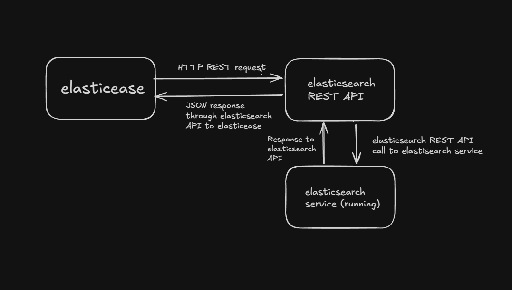
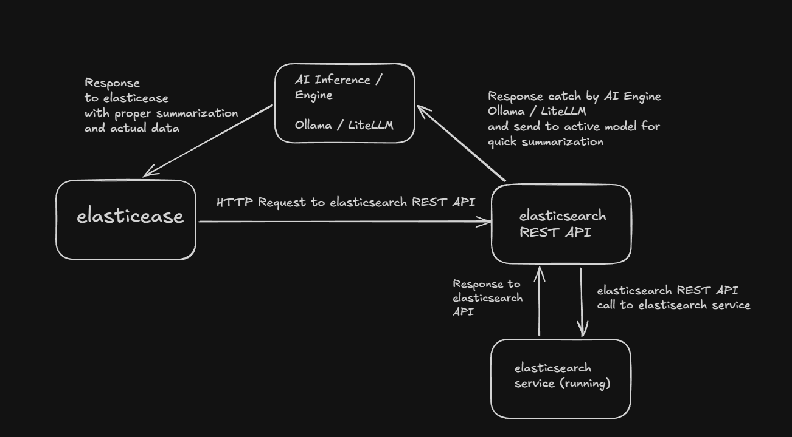

<div align="center">

```
▄▄▄▄▄▄ ▄       ▄▄▄▄▄   ▄▄▄▄▄▄ ▄▄▄▄▄▄▄▄▄ ▄ ▄▄▄▄▄  ▄▄▄▄▄▄  ▄▄▄▄▄   ▄▄▄▄▄▄ ▄▄▄▄▄▄
█      █      █     █ █           █     █ █    ▀ █      █     █ █       █     
█▄▄▄   █      █▄▄▄▄▄▀ █▄▄▄▄▄▄     ▄     █ █      █▄▄▄   █▄▄▄▄▄▀ █▄▄▄▄▄▄ █▄▄▄  
▄      █      █     ▀       ▀     █     █ ▄      ▄      █     ▀       ▀ ▄     
█▄▄▄▄▄ █▄▄▄▄▄ █     █ ▄▄▄▄▄▄▀     █     █ ▀▄▄▄▄▄ █▄▄▄▄▄ █     █ ▄▄▄▄▄▄▀ █▄▄▄▄▄
```

# 🚀 ElasticEase

**The Modern, Developer-Centric Terminal Experience for Elasticsearch.**  
*Effortless cluster management, instant CRUD operations, and AI-powered diagnostics without the REST API boilerplate.*

<br/>

[](https://www.python.org/)
[](https://www.elastic.co/)
[](https://github.com/Textualize/rich)
[](https://ollama.ai/)
[](https://www.python-httpx.org/)
[](LICENSE)

<br/>

### 🧭 Quick Navigation

[](#overview)
[](#the-motive)
[](#architecture)
[](#key-features)
[](#installation)
[](#configuration)
[](#quick-start)
[](#commands-summary)
[](#ai-capabilities)
[](COMMANDS.md)

</div>

---

<a id="overview"></a>
## 💡 Overview

**ElasticEase** is an interactive command-line interface (CLI) tailored for developers, DevOps engineers, and database administrators who interact with **Elasticsearch**. 

Instead of juggling cURL requests, opening Postman, or constantly writing raw queries inside Kibana DevTools, ElasticEase provides a clean, fast terminal interface where you can inspect cluster metrics, manage indices, ingest data, and execute CRUD operations simply by running intuitive commands with arguments.

On top of robust core operations, ElasticEase introduces **AI-powered summarization and diagnostic intelligence** (via **Ollama** or **LiteLLM**), translating raw cluster telemetry, shard distributions, and complex mappings into crystal-clear actionable summaries.

---

<a id="the-motive"></a>
## 🎯 The Motive — Why ElasticEase?

> *"Working with Elasticsearch should be as simple and intuitive as managing a relational database or a local store, not a constant battle with verbose HTTP endpoints."*

### The Problem
When operating an Elasticsearch cluster, developers and administrators find themselves repeatedly doing the same set of routine tasks:
- Running `GET /_cluster/health` to check if shards are unassigned.
- Checking `GET /_cat/indices?v` or `GET /_cat/shards?v` to inspect indices, storage bloat, or replica health.
- Formulating tedious `POST /index/_bulk` NDJSON payloads by hand or writing custom scratch scripts just to insert or update documents.
- Manually handling **Optimistic Concurrency Control (OCC)** (`if_seq_no` and `if_primary_term`) to ensure updates don't overwrite concurrent changes.
- Reading through massive JSON outputs in terminal windows to understand why a cluster turned `yellow` or which node is under heavy JVM memory pressure.

### The Solution: ElasticEase
The core motive behind building **ElasticEase** is to eliminate this friction:
1. **No More Verbose GET/POST Endpoints**: You don't have to write URLs or HTTP methods again and again. Simply type `health`, `shards`, `indices`, or `capacity`.
2. **Simplified Parameter-Driven Operations**: Creating an index with mappings is as simple as `index:new "students" "mappings"`. Adding documents takes a single inline command: `addoc "students" "name=Alice age=22"`.
3. **Built-in Optimistic Concurrency Control (OCC)**: Updating documents (`updoc`, `updocs`) automatically fetches document sequence numbers under the hood, protecting you from lost updates without any manual calculation.
4. **AI-Infused Cluster Diagnostics**: With built-in AI summarization, you get instant plain-English explanations of cluster bottlenecks, JVM heap warnings (>75%), and disk watermark alerts (85%/90%/95%) directly in your terminal.

---

<a id="architecture"></a>
## 🏗 Architecture & Workflow

ElasticEase connects to your Elasticsearch REST API through an asynchronous, non-blocking HTTP engine with live status spinners and latency measurements. When AI mode is invoked, responses are routed to an AI inference engine (local Ollama or LiteLLM gateway) for summarization before displaying the result.

### 1. Standard Request Flow
```
+----------------+   HTTP REST Request   +--------------------+   REST API Call   +-----------------------+
|                | --------------------> |                    | ----------------> |                       |
|   ElasticEase  |                       | Elasticsearch REST |                   | Elasticsearch Service |
|      (CLI)     | <-------------------- |        API         | <---------------- |       (Running)       |
+----------------+     JSON Response     +--------------------+     Response      +-----------------------+
```

<div align="center">
  
</div>

<br/>

### 2. Request Flow with AI Summarization
When an AI flag (`true`) is supplied or global `ai_mode` is enabled, telemetry from Elasticsearch is intercepted by the AI inference engine to produce a human-friendly assessment:

```
                          +------------------------+
                          |      AI Engine         |
                     +--> |   (Ollama / LiteLLM)   | --+
                     |    +------------------------+   |
      Telemetry Data |                                 | Plain-English Summary
                     |                                 v
+----------------+   HTTP Request    +--------------------+    Response     +-----------------------+
|  ElasticEase   | ----------------> | Elasticsearch REST | --------------> | Elasticsearch Service |
|  Terminal UI   | <---------------- |        API         | <-------------- |       (Cluster)       |
+----------------+   Live Latency    +--------------------+    Cluster Data +-----------------------+
```

<div align="center">
  
</div>

---

<a id="key-features"></a>
## ✨ Key Features

- 📊 **Rich Terminal Observability**: Full-color tables, formatted JSON outputs, ASCII branding, and millisecond-accurate network latency indicators powered by `rich` and `httpx`.
- 🩺 **Cluster & Health Monitoring**: Instant visibility into cluster health status (`green`, `yellow`, `red`), primary/replica shard balance, unassigned shards, and active nodes.
- 💾 **Capacity & Storage Allocation**: Inspect disk usage across data nodes with built-in alerts for Elasticsearch low (85%), high (90%), and flood-stage (95%) watermarks.
- ⚡ **Streamlined Index Management**: Create indices dynamically or with guided, interactive custom schema mappings (`index:new`). Delete indices safely with a single command.
- 📝 **Effortless Document CRUD**:
  - Insert single documents with clean `key=value` string arguments (`addoc`).
  - Preview stored documents directly from the terminal (`inspect:doc`, `inspect:index`).
  - Built-in **Optimistic Concurrency Control (OCC)** on updates (`updoc`, `updocs`).
  - Bulk ingestion and bulk deletion from native `.json` files via NDJSON streaming (`addocs`, `deldocs`).
- 🤖 **Dual-Engine AI Intelligence**:
  - **Ollama**: Run private, local, offline LLMs (Llama 3, Mistral, DeepSeek-R1, etc.) for zero-latency, private summaries.
  - **LiteLLM**: Connect to 100+ cloud providers (OpenAI, Anthropic Claude, Google Gemini, OpenRouter, Nvidia NIM) using API keys.
- 🔄 **Live Hot-Config Updating**: Change cluster endpoints (`conn <url>`), credentials (`newpass <password>`), or switch AI inference providers (`ainf switch`) on the fly without manually editing YAML files.

---

<a id="installation"></a>
## 📥 Installation & Setup

### Prerequisites
- **Python**: `3.13` or higher
- **Elasticsearch**: `7.x` or `8.x` (running locally or in cloud)
- *(Optional for AI)*: [Ollama](https://ollama.com/) installed locally OR an API key for any LLM provider via [LiteLLM](https://docs.litellm.ai/docs/).

### 1. Clone the Repository
```bash
git clone https://github.com/Pulsedude/elasticease.git
cd elasticease
```

### 2. Set Up Virtual Environment

#### Option A: Using `uv` (Recommended - Ultra Fast)
```bash
# Create and sync virtual environment automatically
uv sync
```

#### Option B: Using standard `pip` & `venv`
```bash
python -m venv .venv

# On Linux / macOS:
source .venv/bin/activate

# On Windows (PowerShell):
.venv\Scripts\Activate.ps1

# Install dependencies:
pip install -r requirements.txt
# or
pip install httpx litellm pyyaml requests rich
```

---

<a id="configuration"></a>
## ⚙ Configuration

ElasticEase is configured via `config.yaml` located in the root of the project.

```yaml
elasticease:
  # Elasticsearch Connection
  elasticsearch:
    base_url: https://localhost:9200
    username: elastic
    password: your_elastic_password
    verify_certs: false

  # Global AI Mode (true = all supported commands auto-summarize)
  ai_mode: false

  # Select active inference provider: 'ollama' or 'litellm'
  selected_ai_inference: ollama

  # AI Engine Specifications
  ai_inference:
    ollama:
      base_url: http://localhost:11434
      model: llama3:latest
      timeout: 60
    litellm:
      model: openai/gpt-4o-mini # or nvidia/nemotron, anthropic/claude-3-haiku, etc.
      api_key: your_api_key_here
```

### Configuration Parameters

| Section | Key | Type | Description |
|---|---|---|---|
| `elasticsearch` | `base_url` | string | Target Elasticsearch instance URL (e.g. `https://localhost:9200`) |
| `elasticsearch` | `username` | string | Elasticsearch authentication username (e.g. `elastic`) |
| `elasticsearch` | `password` | string | Elasticsearch authentication password |
| `elasticsearch` | `verify_certs` | boolean | Set `false` for self-signed certificates or local dev clusters |
| `ai_mode` | - | boolean | If `true`, all supported core commands will append an AI summary by default |
| `selected_ai_inference` | - | string | Active provider: choose either `ollama` (local) or `litellm` (cloud) |
| `ai_inference.ollama` | `base_url` | string | Ollama server URL (default: `http://localhost:11434`) |
| `ai_inference.ollama` | `model` | string | Model tag installed in Ollama (e.g., `llama3`, `mistral`, `phi3`) |
| `ai_inference.litellm` | `model` | string | Provider-prefixed model ID (e.g., `openai/gpt-4o-mini`, `gemini/gemini-1.5-pro`) |
| `ai_inference.litellm` | `api_key` | string | API key for LiteLLM router or direct cloud vendor |

---

<a id="quick-start"></a>
## 🚀 Quick Start

Launch ElasticEase from your terminal:

```bash
python main.py
```

Upon launch, ElasticEase displays the ASCII banner, tests the cluster connection, reports real-time availability (`🟢` or `🔴`), and presents the interactive prompt:

```text
>>> ping
Base URL: https://localhost:9200
Status: 🟢 Healthy
Latency: 12.350 ms

>>> health
Cluster Health | Latency: 23.411 ms
+-----------------------------------+-----------+
| Work                              | Status    |
+-----------------------------------+-----------+
| cluster_name                      | docker-es |
| status                            | green     |
| number_of_nodes                   | 1         |
| number_of_data_nodes              | 1         |
| active_primary_shards             | 5         |
| unassigned_shards                 | 0         |
+-----------------------------------+-----------+

>>> addoc "students" "name='John Doe' age=21 course='CS'"
{
  "_index": "students",
  "_id": "Y38386ABt5Meyqi5CwMR",
  "result": "created",
  "_seq_no": 0,
  "_primary_term": 1
}
```

---

<a id="commands-summary"></a>
## 📋 Commands Quick Summary

> [!TIP]
> For in-depth specifications, underlying API calls, and examples, see the [📖 Detailed Command Reference Manual](COMMANDS.md).

### Core Observability Commands

| Command | Arguments | Description | AI Support |
|---|---|---|:---:|
| [`health`](COMMANDS.md#1-health) | `[json] [true/false]` | Cluster health status, shard reallocation, and active nodes | 🤖 Yes |
| [`shards`](COMMANDS.md#2-shards) | `[json] [true/false]` | Shards distribution, primary vs replica states, and memory size | 🤖 Yes |
| [`indices`](COMMANDS.md#3-indices) | `[json] [true/false]` | List indices with health, doc count, deleted docs, and storage | 🤖 Yes |
| [`ping`](COMMANDS.md#4-ping) | `[true]` | Heartbeat check to measure latency and node responsiveness | 🤖 Yes |
| [`indexinfo`](COMMANDS.md#5-indexinfo) | `<index_name> [true]` | Detailed schema mappings, data types, and index settings | 🤖 Yes |
| [`master`](COMMANDS.md#6-master) | `[json]` | View elected master node details (ID, IP, host) | ❌ No |
| [`nodes`](COMMANDS.md#7-nodes) | `[json] [true/false]` | Node telemetry: JVM heap %, RAM %, CPU %, load averages | 🤖 Yes |
| [`capacity`](COMMANDS.md#8-capacity) | `[json] [true/false]` | Disk storage allocations, available headroom, and disk % | 🤖 Yes |
| [`conn`](COMMANDS.md#9-conn) | `<base_url>` | Dynamically update Elasticsearch connection URL | ❌ No |
| [`ainf`](COMMANDS.md#10-ainf) | `[switch]` | View active AI inference provider or toggle between Ollama and LiteLLM | ❌ No |
| [`newpass`](COMMANDS.md#11-newpass--newcred) | `<password>` | Dynamically update cluster credentials | ❌ No |
| [`help`](COMMANDS.md#12-help) | `[command_name]` | Interactive Markdown documentation viewer | ❌ No |
| [`clear`](COMMANDS.md#13-clear--cls) | *none* | Clear terminal screen (`clear` / `cls`) | ❌ No |
| [`exit`](COMMANDS.md#14-exit--quit--q) | *none* | Exit ElasticEase session (`exit` / `quit` / `q`) | ❌ No |

### CRUD & Document Commands

| Command | Arguments | Description | Safety Prompt |
|---|---|---|:---:|
| [`index:new`](COMMANDS.md#15-indexnew) | `<index_name> [mappings]` | Create new index (dynamic or interactive custom schema) | ⚠️ On mappings |
| [`index:del`](COMMANDS.md#16-indexdel) | `<index_name>` | Delete an existing index and its stored data | ❌ Direct |
| [`inspect:doc`](COMMANDS.md#17-inspectdoc) | `<index_name> <doc_id>` | Fetch and display a specific document by its ID | ❌ Direct |
| [`inspect:index`](COMMANDS.md#18-inspectindex) | `<index_name>` | Search and preview documents inside an index | ❌ Direct |
| [`addoc`](COMMANDS.md#19-addoc) | `<index_name> <key=values>` | Insert a single document from key-value pairs | ❌ Direct |
| [`addocs`](COMMANDS.md#20-addocs) | `<index_name> <file.json>` | Bulk ingest multiple documents from a `.json` file | ❌ Direct |
| [`updoc`](COMMANDS.md#21-updoc) | `<index_name> <doc_id> <key=values>` | Update document with Optimistic Concurrency Control (OCC) | ❌ Direct |
| [`updocs`](COMMANDS.md#22-updocs) | `<index_name> <file.json>` | Bulk update multiple documents with OCC validation | ⚠️ `[Y]/[N]` |
| [`deldoc`](COMMANDS.md#23-deldoc) | `<index_name> <doc_id>` | Delete single document by ID | ❌ Direct |
| [`deldocs`](COMMANDS.md#24-deldocs) | `<index_name> <targets.json>` | Bulk delete multiple documents via `_bulk` API | ⚠️ `[Y]/[N]` |

---

<a id="ai-capabilities"></a>
## 🤖 AI Capabilities & Intelligence

ElasticEase is designed to bridge the gap between complex raw metrics and actionable insights. When AI mode is triggered (either globally or per-command), ElasticEase passes the structured response to your selected LLM with a specialized diagnostic prompt.

### 1. On-Demand vs Global Mode
- **On-Demand**: Keep `ai_mode: false` in `config.yaml` to enjoy ultra-fast raw responses. When you spot an issue, simply append `true` to your command:
  ```bash
  >>> nodes true
  >>> capacity json true
  >>> indexinfo "orders" true
  ```
- **Global**: Set `ai_mode: true` in `config.yaml`. Every core command automatically renders both the data table/JSON and the AI summary.

### 2. What the AI Checks For You
- 🧠 **JVM Heap Pressure**: Analyzes JVM memory consumption across nodes. Flags any node exceeding **75% heap usage** to prevent Garbage Collection pauses or `OutOfMemoryError`.
- 💽 **Disk Watermark Hazards**: Scans node allocation metrics and alerts you if any node nears Elasticsearch's **85% low**, **90% high**, or **95% flood-stage** watermarks before your indices get locked into read-only mode.
- 🔀 **Shard Health & Allocation**: Identifies unassigned or relocating shards and explains why a cluster might be in a `yellow` or `red` state (e.g., replica count exceeds available nodes).
- 🧬 **Schema & Mapping Optimization**: Analyzes index mappings and warns about unindexed fields, unneeded full-text mappings for IDs, or missing keyword normalizers.

### 3. Switching Inference Providers on the Fly
Easily inspect or toggle your active inference engine between local Ollama models and cloud LiteLLM endpoints without touching `config.yaml`:
```bash
>>> ainf          # View active provider (e.g. "ollama" or "litellm")
>>> ainf switch   # Toggle active provider between Ollama and LiteLLM
```

---

## 📁 Project Directory Structure

```text
elasticease/
├── ascii.txt              # ASCII art header banner
├── config.yaml            # Central configuration (Elasticsearch & AI credentials)
├── pyproject.toml         # Project dependencies and packaging metadata
├── README.md              # Project overview and quick start guide
├── COMMANDS.md            # In-depth reference manual for all commands
├── main.py                # Main entrypoint application
├── onstart.py             # Startup health probe, banner, and commands display
├── workflow/              # Architectural workflow diagrams
│   ├── main_working_flow.png
│   └── working_flow_with_ai_summarization.png
└── src/                   # Core application engine
    ├── __init__.py
    ├── ai_inference.py    # Ollama & LiteLLM provider integrations
    ├── command_input_gateway.py # Command parser and dispatcher
    ├── commands.py        # Command catalog & metadata
    ├── config.py          # YAML config read/write handler
    ├── core_operations.py # Cluster, node, health, and capacity logic
    ├── crud_operations.py # Index and document CRUD operations with OCC
    ├── request.py         # Async HTTPX client with latency timers & spinners
    └── utils.py           # String parsers, mapping converters, and validators
```

---

## 🤝 Contributing

Contributions, bug reports, and feature requests are welcome!
1. Fork the repository.
2. Create your feature branch (`git checkout -b feature/awesome-feature`).
3. Commit your changes (`git commit -m 'feat: add awesome feature'`).
4. Push to the branch (`git push origin feature/awesome-feature`).
5. Open a Pull Request.

---

## 📄 License

This project is open-source and distributed under the **MIT License**.

<div align="center">
  <b>Built with ❤️ to make Elasticsearch effortless.</b>
</div>